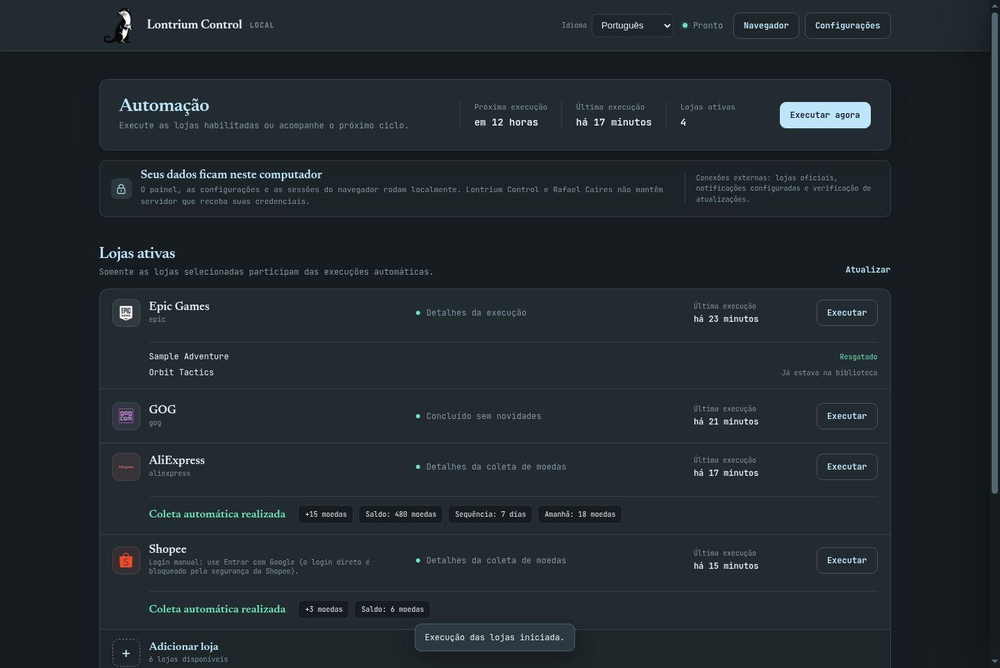
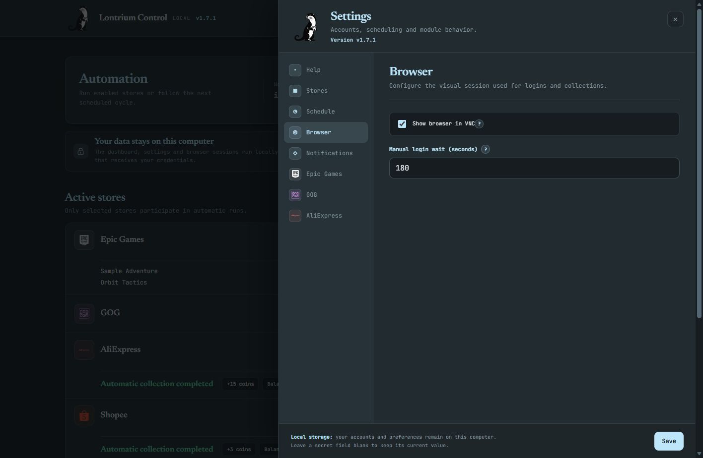
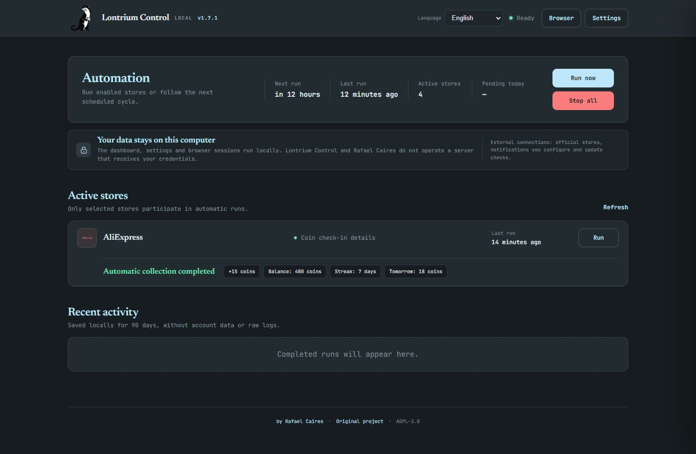
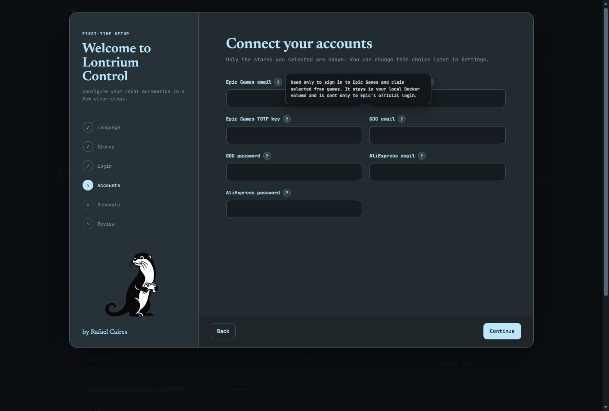

<p align="center">
  
</p>

<h1 align="center">Lontrium Control</h1>

<p align="center">
  <strong>Your free-game claims and daily rewards, organized in one private local dashboard.</strong><br>
  Install once, choose your stores, and let Lontrium Control handle the routine.
</p>

<p align="center">
  <a href="./LICENSE"></a>
  
  
  
</p>

<p align="center">
  <a href="./README.md">English</a> ·
  <a href="./docs/README.pt-BR.md">Português do Brasil</a> ·
  <a href="./docs/README.es.md">Español</a>
</p>

<p align="center">
  <a href="https://github.com/rafaelcairess/lontrium/releases/latest/download/Lontrium-Setup.exe"><strong>Download Lontrium Control for Windows</strong></a>
</p>

> [!NOTE]
> **Lontrium Control v1.7.1 is the current release.** Download the installer above and verify it with [`SHA256SUMS.txt`](https://github.com/rafaelcairess/lontrium/releases/latest/download/SHA256SUMS.txt).

<p align="center">
  
</p>

## What it does

- Claims eligible free games, assets and rewards from your selected stores.
- Collects daily coin rewards from AliExpress and Shopee and shows the result and balance.
- Shows the actual result of each run instead of only a generic success count.
- On Windows, uses native scheduled tasks at the chosen times (12:00, 16:00 and 19:00 by default), catches up missed times, then releases Docker/WSL memory.
- Before a scheduled Windows run, checks host RAM, CPU, GPU and the active fullscreen/high-load application. If the machine is busy, Docker is not started and the run is deferred to the next configured time; the final daily slot runs through soft pressure, but not critical low-memory pressure.
- The resource check is automatic: users do not need to maintain a protected-games list. The next scheduled time is shown in the Windows notification when a run is deferred.
- Skips stores already completed that day and retries only stores that failed, need login/CAPTCHA or have not run yet.
- Opens a visual browser whenever a store requires manual login or confirmation.
- Keeps the dashboard, settings, database and browser sessions on your computer.
- Preserves a privacy-safe 90-day activity history across container restarts and app updates.
- Lets each store run independently, so a login wait in one store does not hide the controls for another supported independent run.

## Supported services

| Service | What Lontrium checks | First login |
|---|---|---|
| Epic Games | Free PC games and eligible Android/iOS offers | Saved credentials or visual browser |
| GOG | Current giveaways | Saved credentials or visual browser |
| Prime Gaming | Included games and supported redemption flows | Saved credentials or visual browser |
| Steam, Ubisoft, Fab and Unity | Supported free offers and assets | Depends on the store flow |
| AliExpress | Daily coin check-in, reward, balance and streak | Saved credentials or visual browser |
| Shopee | Daily coin check-in and balance | **Visual browser with Continue with Google** |
| GamerPower | Giveaway discovery and compatible partner claims | Depends on the destination store |

GamerPower can route compatible giveaways from Fanatical, itch.io and IndieGala. Store availability, regional offers and authentication requirements are controlled by each official service.

> [!IMPORTANT]
> **Shopee requires a one-time manual login through _Continue with Google_.** In our live test, Shopee's security rejected direct account login inside the Docker browser, while Google login succeeded. Lontrium does not attempt to bypass that protection; after the Google login, the local persistent browser profile reuses the session.

## Install in three steps

1. Download `Lontrium-Setup.exe` from the [latest Release](https://github.com/rafaelcairess/lontrium/releases).
2. Run it. If Docker Desktop is missing, the launcher explains why it is needed and installs it from Docker's official source only after your confirmation.
3. Follow the local setup assistant. It recommends browser login, shows only settings relevant to your selected stores and offers simple automation presets.

That is all. You do not need to clone the repository, edit configuration files or type Docker commands.

> [!TIP]
> **You do not have to give Lontrium your passwords.** For every supported store that requires an account, choose browser login and sign in directly on the official website. Lontrium keeps the resulting browser session in the local Docker volume and reuses it until that store asks you to authenticate again.

The installer may request administrator permission or a Windows restart while Docker Desktop is installed. Because the first installer is unsigned, Windows SmartScreen may display an unknown-publisher warning. Every Release includes `SHA256SUMS.txt` so the download can be verified.

## First-time setup

The assistant asks six practical questions instead of exposing the full environment configuration:

1. **Language** — automatically detected from Windows/browser; English, Brazilian Portuguese and Spanish are available.
2. **Stores** — only selected stores appear on the dashboard or participate in scheduled runs.
3. **Login method** — browser login is recommended; saving supported credentials locally remains optional.
4. **Accounts** — when browser login is selected, no password is requested. Otherwise, only fields for selected stores are shown.
5. **Automation** — choose automatic economy mode (recommended), an always-available dashboard, or manual-only use. Economy times are editable.
6. **Review** — confirms where data stays and explains exactly what will happen after finishing.

After **Finish and run**, Lontrium opens the dashboard and starts the selected services. If a store needs authentication, open **Browser**, finish the login on the official page and return to the dashboard. The browser profile is persistent, so this is normally required only on first use or after the store expires its own session.

You can revisit the complete introduction later from **Settings → Help**. Help explains sessions, optional credentials and store dependencies; the introduction opens in preview mode and does not overwrite settings or start a run.

## How it works

```text
Windows Task Scheduler (configured daily times + missed-run catch-up)
      │
      ├─ checks host resources before starting Docker
      ├─ defers to the next configured time when the computer is busy
      ├─ starts Docker Desktop and the local container only when needed
      ├─ runs stores without a successful result for the current local day
      └─ stops resources it started after the run
                 │
                 ├─ dashboard → http://127.0.0.1:8080
                 ├─ visual browser → http://127.0.0.1:7080
                 └─ local volume
                       ├─ settings and optional credentials
                       ├─ separate browser profile per store
                       └─ sanitized 90-day result history
```

Each store module opens the corresponding official website, checks the current offer or reward and records a structured result. Games show their titles and outcomes. AliExpress and Shopee show collected coins and any balance/streak information the official page exposes. CAPTCHA, anti-fraud and account verification are handed back to the user in the visual browser; Lontrium never attempts to bypass them. On Windows, the installer includes a small native helper that can notify you when a CAPTCHA needs attention and open the local browser session with one click.

## Your data stays local

Lontrium Control has no account server and includes no telemetry.

| What happens | Where it happens |
|---|---|
| Dashboard and settings | On `127.0.0.1`, available only from this computer |
| Credentials and browser sessions | In the local Docker volume |
| Sanitized run history | In the local SQLite database for 90 days |
| Store login | Directly between the automated browser and the store's official website |
| Saved secret API response | Only `configured: true/false`; the password is never sent back to the dashboard |
| Updates | Checked against this project's official GitHub Releases |

Credentials are optional; manual browser login is always available. Locally saved secrets are not protected by an external encryption server, so your Windows account and disk must remain secure. Lontrium Control never attempts to bypass CAPTCHA, anti-fraud or security challenges.

## Interface tour

The dashboard is designed to answer three questions quickly: what is enabled, what happened last time and what needs attention. Only selected stores appear in the active list, while each result shows the actual game, reward or coin outcome.

<p align="center">
  
</p>

<table>
  <tr>
    <td width="50%" valign="top">
      <p align="center"><strong>Help and login model</strong></p>
      
    </td>
    <td width="50%" valign="top">
      <p align="center"><strong>Store selection</strong></p>
      
    </td>
  </tr>
  <tr>
    <td width="50%" valign="top">
      <p align="center"><strong>Schedule</strong></p>
      
    </td>
    <td width="50%" valign="top">
      <p align="center"><strong>Browser session</strong></p>
      
    </td>
  </tr>
  <tr>
    <td width="50%" valign="top">
      <p align="center"><strong>Notifications</strong></p>
      
    </td>
    <td width="50%" valign="top">
      <p align="center"><strong>AliExpress result</strong></p>
      
    </td>
  </tr>
</table>

The six-step introduction keeps browser login as the recommended path. If optional autofill is selected, only the relevant credential fields are shown and each field has an immediate `?` explanation:

<p align="center">
  
</p>

The interface supports mouse, keyboard and touch, and is fully translated into English, Brazilian Portuguese and Spanish.

## Daily use

- Open **Lontrium Control** from the Start menu or desktop shortcut.
- Use **Run now** for all enabled stores or run one store individually.
- Use **Stop all** if a store becomes stuck. Lontrium cancels the current queue and, on Windows, closes Docker when no unrelated container is running.
- Use **Browser** when a store asks for login, CAPTCHA or manual confirmation.
- Enable **Windows notifications for manual actions** to receive one local alert per detected CAPTCHA. The helper reads only a secret-free event from `127.0.0.1`; it does not send account data anywhere.
- Use **Settings** to change stores, accounts, notifications or scheduling.
- Automatic runs protect interactive work: a detected high-load fullscreen application, CPU/GPU pressure or low RAM postpones the run to the next configured time. The final daily slot is still attempted unless memory pressure is critical.
- Updates are offered in the dashboard and preserve the local volume.

When upgrading from the older Free Games Claimer layout, the launcher may ask whether it should reuse existing local accounts and sessions. Choose **Yes** unless you intentionally want a clean profile. Lontrium changes the container and application image, not the selected persistent data volume.

The normal shortcut still opens the dashboard on demand. In automatic economy mode, Windows triggers Lontrium at the configured times (12:00, 16:00 and 19:00 by default) and catches up a missed time when the PC returns. A store that succeeds once is skipped for the rest of that local day; only unfinished stores retry later. Docker Desktop, the container and the notification helper are stopped afterward only when that scheduled run started them. Manual dashboards also stop after 30 minutes without real user activity. Nothing from Lontrium remains resident between runs. If Docker or the dashboard was already open, Lontrium leaves it open. Uninstalling removes only Lontrium's scheduled task and keeps accounts and sessions unless local-data deletion is explicitly selected.

## Need help?

| Problem | What to try |
|---|---|
| Dashboard did not open | Open [http://127.0.0.1:8080](http://127.0.0.1:8080) and confirm Docker Desktop is running. |
| A store needs attention | Open the visual browser from the dashboard and complete the official store prompt. |
| A session expired | Sign in again through the visual browser; the refreshed session is kept locally. |
| A claim failed | Retry the individual store and include the relevant sanitized log when opening an issue. |

For bugs and feature requests, use [GitHub Issues](https://github.com/rafaelcairess/lontrium/issues). Never publish passwords, cookies, TOTP keys, complete network captures or unsanitized screenshots.

### Login, Help and credentials

Browser login is the recommended path. Lontrium stores the resulting session in the local browser profile and reuses it until the official store expires it. Saved email, username, password and TOTP fields are optional autofill helpers; a blank secret field preserves the existing value.

Shopee is browser-session only. Fab reuses the Epic Games session and does not need separate credentials. GamerPower can enable optional Fanatical, itch.io and IndieGala sources. When AliExpress remembers your email and shows only the password field, Lontrium keeps the remembered email, attempts the password and waits for a real session confirmation. CAPTCHA, Google login and security-code steps remain in Browser for manual completion.

Settings now shows only selected store modules. Use **Settings → Help** to reopen the six-step introduction without changing settings or starting a run. The same area explains Apprise URL, Discord webhook, session persistence and store dependencies.

## For contributors

The installer is the supported path for end users. Source builds, architecture and environment variables are developer-facing topics:

- [`.env.example`](./.env.example) — complete source-build configuration reference
- [`MODIFICATIONS.md`](./MODIFICATIONS.md) — implementation history and technical differences
- [`CHANGELOG.md`](./CHANGELOG.md) — release changes
- [`docs/RESOURCE_GUARD_VERIFICATION.md`](./docs/RESOURCE_GUARD_VERIFICATION.md) — resource-protection behavior and local verification

The test suite covers store logic, the local API, secret handling, translations, setup flow and the Windows launcher.

## Credits and license

**Lontrium Control interface and Windows distribution:** [Rafael Caires](https://github.com/rafaelcairess).

Built on [P-Adamiec/Free-Games-Claimer-Remaster](https://github.com/P-Adamiec/Free-Games-Claimer-Remaster), maintained by Paweł Adamiec and its contributors. That project was inspired by [vogler/free-games-claimer](https://github.com/vogler/free-games-claimer). Third-party notices are listed in [`THIRD_PARTY_NOTICES.md`](./THIRD_PARTY_NOTICES.md).

Distributed under the [GNU Affero General Public License v3.0](./LICENSE).
