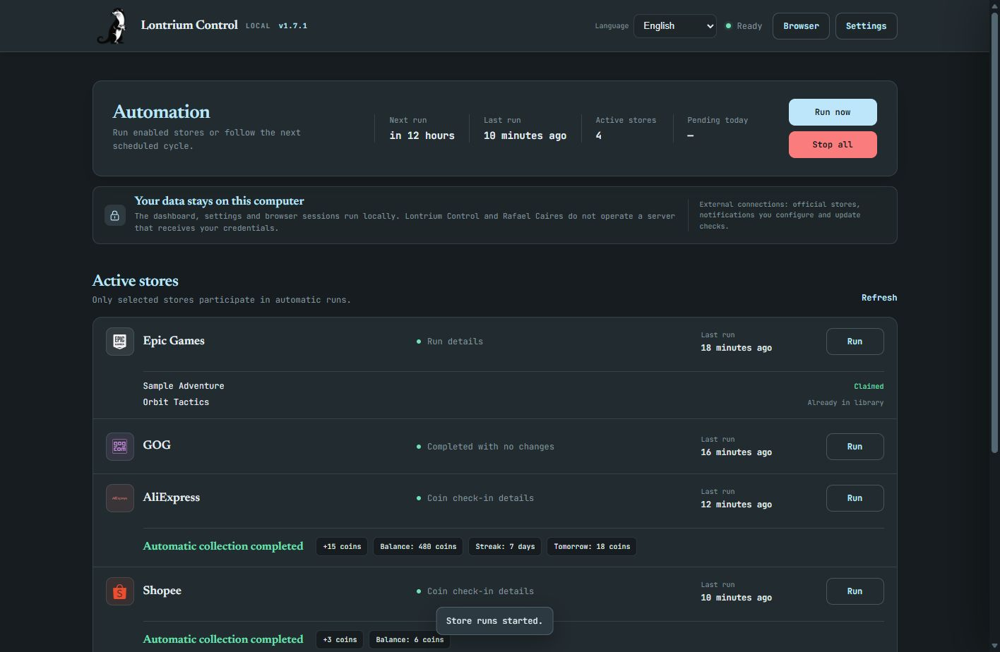
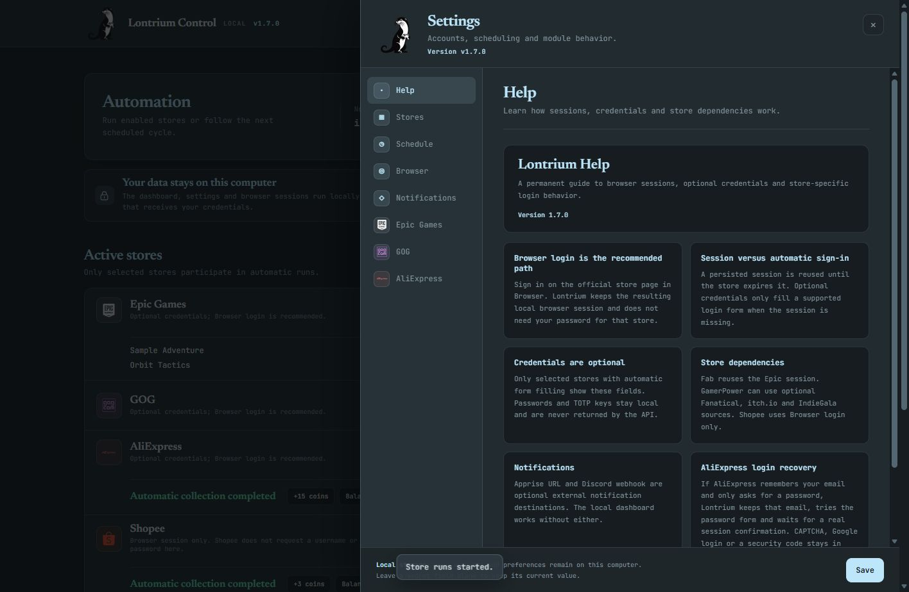
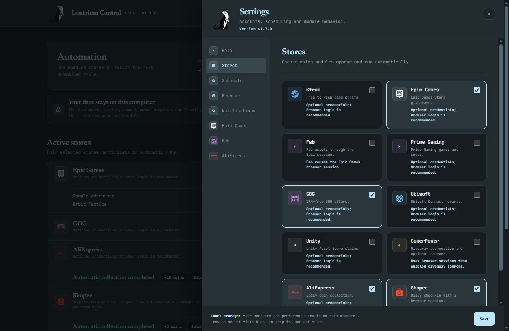
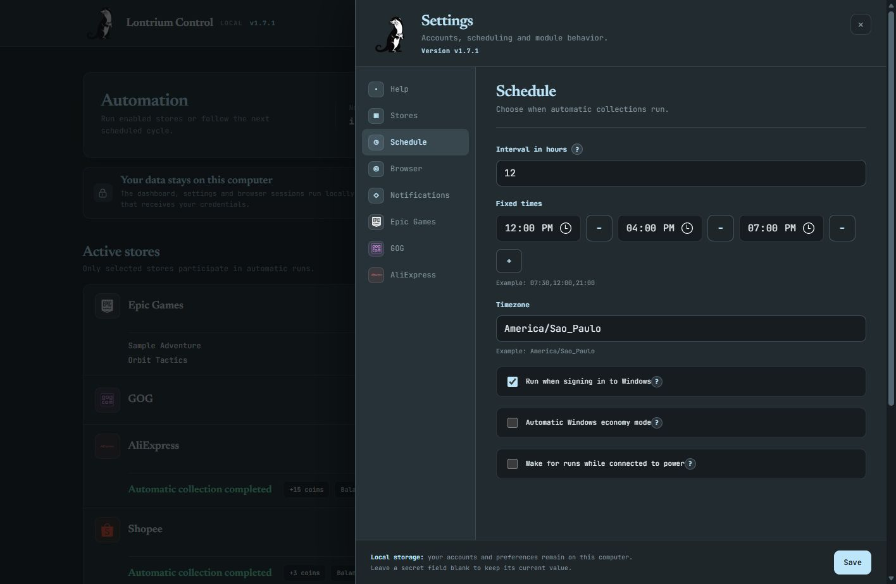
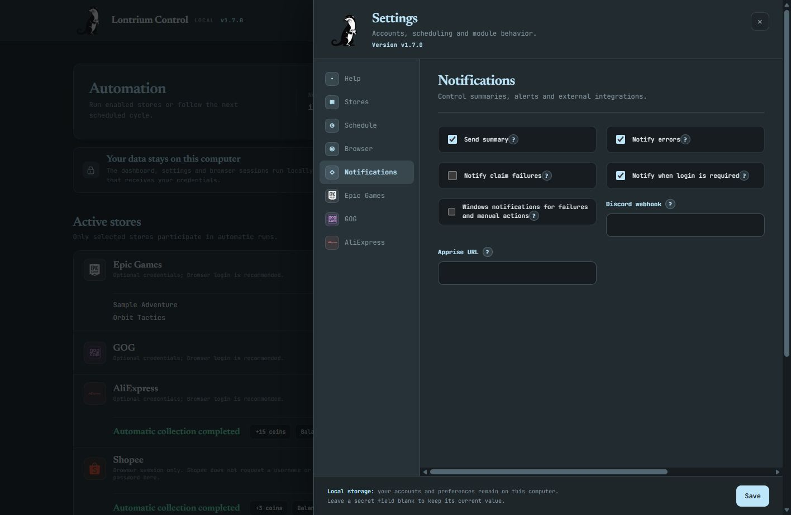

<div align="center">


# Lontrium Control

### Jogos grátis, recompensas diárias e ofertas digitais em um único painel local.

O Lontrium automatiza tarefas repetitivas em lojas oficiais, preserva as sessões no seu computador
e sabe esperar quando você está jogando ou usando um aplicativo pesado.

<p>
  <a href="https://github.com/rafaelcairess/lontrium/releases/latest"></a>
  <a href="https://github.com/rafaelcairess/lontrium/actions/workflows/release.yml"></a>
  <a href="./LICENSE"></a>
</p>

<p>
  
  
  
  
</p>

[**Baixar para Windows**](https://github.com/rafaelcairess/lontrium/releases/latest/download/Lontrium-Setup.exe)
· [Ver o produto](#visão-do-produto)
· [Entender a arquitetura](#como-funciona)
· [Abrir uma issue](https://github.com/rafaelcairess/lontrium/issues)

<br>



</div>

## Por que o Lontrium existe?

Jogos gratuitos, moedas diárias e ofertas temporárias ficam espalhados por diferentes lojas. Acompanhar tudo manualmente exige abrir vários sites, lembrar horários e repetir os mesmos passos todos os dias.

O **Lontrium Control** reúne essa rotina em uma interface única. Ele executa somente os módulos escolhidos, mostra o resultado real de cada tentativa e devolve o controle ao usuário quando encontra login, CAPTCHA ou verificação de segurança.

## Principais recursos

<table>
  <tr>
    <td width="33%" valign="top">
      <strong>Jogos e recompensas</strong><br>
      Verifica ofertas elegíveis e coleta recompensas diárias das lojas habilitadas.
    </td>
    <td width="33%" valign="top">
      <strong>Agendamento inteligente</strong><br>
      Executa nos horários escolhidos e não repete o que já foi concluído no dia.
    </td>
    <td width="33%" valign="top">
      <strong>Proteção de recursos</strong><br>
      Analisa RAM, CPU, GPU e aplicativos em tela cheia antes de iniciar o Docker.
    </td>
  </tr>
  <tr>
    <td width="33%" valign="top">
      <strong>Login pelo navegador</strong><br>
      Mantém sessões locais e deixa credenciais salvas como recurso opcional.
    </td>
    <td width="33%" valign="top">
      <strong>Privacidade local</strong><br>
      Dashboard, configurações, sessões e histórico permanecem no computador.
    </td>
    <td width="33%" valign="top">
      <strong>Resultados claros</strong><br>
      Exibe jogos, moedas, saldo, sequência e ações que ainda precisam de atenção.
    </td>
  </tr>
</table>

## Integrações

| Categoria | Módulos | Autenticação |
| --- | --- | --- |
| Jogos e ativos | Epic Games, GOG, Prime Gaming, Steam, Ubisoft, Fab e Unity | Sessão do navegador ou preenchimento opcional, conforme a loja |
| Recompensas diárias | AliExpress e Shopee | AliExpress aceita preenchimento opcional; Shopee usa login manual |
| Descoberta de ofertas | GamerPower, Fanatical, itch.io e IndieGala | Depende da loja de destino |

O Fab reutiliza a sessão da Epic Games. O Lontrium não tenta contornar CAPTCHA, antifraude, login social ou confirmação por código.

## Comece em três passos

1. Baixe o [instalador da versão mais recente](https://github.com/rafaelcairess/lontrium/releases/latest/download/Lontrium-Setup.exe).
2. Execute o instalador e conclua o assistente inicial.
3. Escolha as lojas e faça login no navegador visual quando solicitado.

O instalador cria o atalho do Lontrium e prepara a execução local. Se o Docker Desktop estiver ausente, o launcher explica por que ele é necessário e solicita confirmação antes da instalação.

> [!TIP]
> O login pelo navegador é recomendado. A sessão fica no perfil local e é reutilizada até a própria loja solicitar uma nova autenticação.

## Visão do produto

<table>
  <tr>
    <td width="50%" valign="top">
      
      <p align="center"><strong>Ajuda e modelo de login</strong></p>
    </td>
    <td width="50%" valign="top">
      
      <p align="center"><strong>Seleção de lojas</strong></p>
    </td>
  </tr>
  <tr>
    <td width="50%" valign="top">
      
      <p align="center"><strong>Automação e horários</strong></p>
    </td>
    <td width="50%" valign="top">
      
      <p align="center"><strong>Alertas e integrações</strong></p>
    </td>
  </tr>
</table>

## Como funciona

```text
Agendador do Windows
        │
        ├── verifica CPU, GPU, memória e aplicativo em primeiro plano
        ├── adia a execução quando o computador está ocupado
        ├── inicia Docker e o container somente quando necessário
        ├── executa apenas os módulos ainda pendentes no dia
        └── libera os recursos iniciados pelo próprio Lontrium
                │
                ├── Dashboard local  →  127.0.0.1:8080
                ├── Navegador visual →  127.0.0.1:7080
                └── Volume local
                      ├── configurações
                      ├── sessões separadas por loja
                      └── histórico sanitizado de 90 dias
```

### Decisões de engenharia

| Camada | Implementação | Objetivo |
| --- | --- | --- |
| Automação | Python assíncrono, nodriver e Chrome DevTools Protocol | Controlar os sites com sessões persistentes e intervenção visual |
| Agendamento | APScheduler e Agendador de Tarefas do Windows | Recuperar horários perdidos e evitar execuções duplicadas |
| Estado local | SQLite assíncrono e SQLAlchemy | Preservar resultados e configurações entre atualizações |
| Interface | Servidor HTTP local, JavaScript, HTML e CSS | Entregar um painel leve sem depender de um serviço externo |
| Distribuição | Docker, PowerShell e Inno Setup | Fornecer instalação e atualização reproduzíveis no Windows |
| Qualidade | pytest, testes de interface, validação de idiomas e GitHub Actions | Verificar os fluxos antes de cada release |

## Privacidade por padrão

- O painel responde apenas em `127.0.0.1`.
- Sessões e credenciais opcionais ficam no volume local do Docker.
- Valores secretos nunca são devolvidos ao frontend; ele recebe somente o estado “configurado”.
- Não há servidor de contas ou telemetria operado pelo projeto.
- Atualizações são verificadas nas releases oficiais deste repositório.

## Desenvolvimento

<details>
<summary><strong>Executar verificações locais e consultar a documentação técnica</strong></summary>

<br>

O instalador é o caminho recomendado para usuários finais. Para trabalhar no código-fonte, consulte [`.env.example`](./.env.example) e [`MODIFICATIONS.md`](./MODIFICATIONS.md).

```powershell
python -m pytest -q
node --check src/gui/static/app.js
node --test tests/test_i18n.js
```

A suíte cobre módulos de loja, API local, segredos, traduções, onboarding, launcher Windows e agendamento.

</details>

## Links do projeto

- [Releases e instalador](https://github.com/rafaelcairess/lontrium/releases)
- [Histórico de alterações](./CHANGELOG.md)
- [Manual completo em português](./docs/README.pt-BR.md)
- [Documentação em espanhol](./docs/README.es.md)
- [Verificação da proteção de recursos](./docs/RESOURCE_GUARD_VERIFICATION.md)
- [Notas de terceiros](./THIRD_PARTY_NOTICES.md)

## Créditos

Criado e mantido por **[Rafael Caires](https://github.com/rafaelcairess)**.

O Lontrium foi construído a partir do [Free-Games-Claimer-Remaster](https://github.com/P-Adamiec/Free-Games-Claimer-Remaster), mantido por Paweł Adamiec e colaboradores, e inspirado no [free-games-claimer](https://github.com/vogler/free-games-claimer).

Distribuído sob a [GNU Affero General Public License v3.0](./LICENSE).

<div align="center">

Se o projeto for útil para você, deixe uma ⭐. Isso ajuda outras pessoas a encontrarem o Lontrium.

</div>
